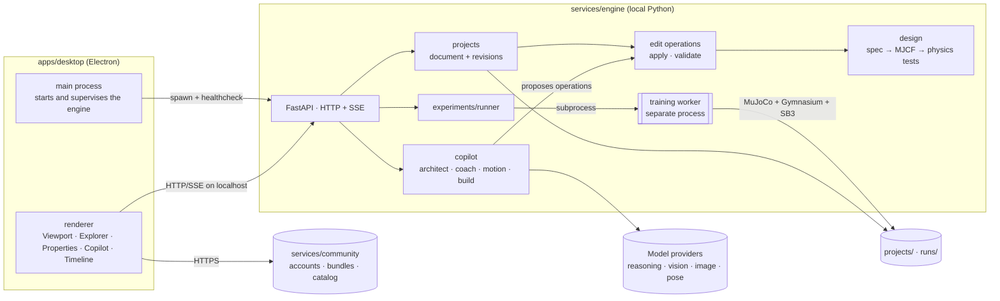

# Architecture

This document explains how Icarus Studio 3D is built. Product direction lives in [`VISION.md`](../VISION.md); when the two disagree, the vision wins and this document is updated.

## System overview

Icarus Studio 3D has three parts:

- **Desktop studio** (`apps/desktop`): Electron, React and React Three Fiber. A 3D editor that expresses intent and renders state.
- **Engine** (`services/engine`): a local Python service that owns projects, the parts library, design compilation, the copilot, simulation, training, motion, hardware export and storage.
- **Community service** (`services/community`): an online service for accounts and for publishing, browsing and downloading creations.



**Authority.** The renderer expresses intent and renders state. The engine validates, orchestrates and owns the data. MuJoCo is the only source of physical truth; the viewport draws the compiled physical model and replays states MuJoCo computed.

## Core idea: one project document, one edit model

Everything a user creates lives in a **project document**: a typed, versioned description of a world, one or more bodies, a task and a brain.

```text
Project
├── WorldSpec      terrain, surfaces, static and dynamic objects, goals, lighting
├── BodySpec[]     parts tree: rigid parts, joints, actuators, sensors, skin
├── TaskSpec       task family, observations, actions, reward terms + weights, terminations
├── BrainSpec      algorithm, network template, training budget, randomization
└── HardwareProfile?  real components the bodies must be built from
```

The document changes only through **edit operations** (`add_part`, `connect_joint`, `set_joint_limits`, `add_sensor`, `set_reward_weight`, `set_surface_friction`, …). The editor emits operations when a user drags a gizmo or edits a property; the copilot emits the same operations when it designs or repairs something. The engine applies them, validates the result and records a revision.

This gives every change, human or AI, the same guarantees: validated before it lands, visible as a diff, undoable, and attributable in the revision history. The copilot has no other way to change a project.

## Repository layout

```text
icarus-studio-3d/
├── AGENTS.md                 # rules for agents and contributors
├── VISION.md                 # product truth
├── README.md
├── package.json              # root scripts orchestrating TS + Python
├── pnpm-workspace.yaml
├── biome.json
├── .env.example
├── apps/
│   └── desktop/
│       ├── AGENTS.md
│       └── src/
│           ├── main/         # window, engine process supervision
│           ├── preload/      # contextBridge API
│           └── renderer/
│               ├── app/      # launcher and workspace shells, headers, routing, dock layout
│               ├── editor/   # viewport, toolbar, gizmos, selection, explorer, inspector, property controls, undo
│               ├── features/
│               │   ├── copilot/         # chat, history, ideas, proposal previews, autopilot
│               │   ├── world-studio/    # world tools, library, training copies
│               │   ├── body-studio/     # rig, import, auto-rig, rig check
│               │   ├── brain-studio/    # senses and actions, learning, brain shape, connectome activity
│               │   ├── play/            # Play mode: tools, senses, decisions, vision, events
│               │   ├── timeline/        # runs, metrics, results, failures, reference comparison, timelapse
│               │   ├── motion-studio/   # reference video → motion → export
│               │   ├── build/           # build targets, export, hardware, publish
│               │   ├── projects/        # project list, project menu, rename, duplicate, delete
│               │   ├── settings/        # AI models, profile, privacy, training, notifications
│               │   └── community/       # browse, creation pages, report, profile, sign-in
│               ├── scene/    # R3F rendering of compiled models, rollouts and Play streams
│               ├── engine-client/       # typed HTTP + SSE client for the engine
│               ├── community-client/    # typed client for the community service
│               └── ui/       # shadcn components on top of the design tokens
├── packages/
│   ├── contracts/            # TypeScript types generated from the engine
│   └── ui-tokens/            # design tokens: one TS source → CSS variables, Tailwind theme, scene constants
├── services/
│   ├── engine/
│   │   ├── AGENTS.md
│   │   ├── pyproject.toml
│   │   ├── src/icarus/
│   │   │   ├── api/          # FastAPI routers
│   │   │   ├── contracts/    # Pydantic models: the single contract
│   │   │   ├── library/      # parts, joints, actuators, sensors, surfaces, reward terms, templates, hardware components
│   │   │   ├── projects/     # project store, revisions, edit operations
│   │   │   ├── design/       # spec → MJCF compiler, design tests
│   │   │   ├── copilot/      # model client, capabilities, roles, prompts
│   │   │   ├── experiments/  # run store, runner
│   │   │   ├── sim/          # Gymnasium envs from specs, reward composition, randomization, rendering, scene export
│   │   │   ├── training/     # worker, PPO, imitation, checkpoints, evaluation, rollouts
│   │   │   ├── motion/       # pose extraction, retargeting, reference clips, animation export
│   │   │   ├── hardware/     # profiles, parts lists, URDF/ONNX export, runtime package
│   │   │   └── bundles/      # pack and unpack shareable bundles
│   │   └── tests/
│   └── community/            # online service: accounts, bundle storage, catalog
├── assets/
│   ├── library/              # meshes and textures for library parts and presets, with licenses
│   └── presets/              # ready-made bodies and worlds (including commercial robots)
├── projects/                 # local projects (not versioned)
├── runs/                     # local training output (not versioned)
└── docs/
    ├── architecture.md
    ├── design/               # screen catalog, style guide, design tokens
    ├── decisions/            # ADRs
    ├── agents/               # detailed guides referenced from AGENTS.md
    └── plans/                # working plans
```

- **pnpm workspaces without a task runner.** Root scripts call both languages, so `pnpm check` verifies the whole repo.
- **The contract lives in Python** next to the validation that enforces it; `packages/contracts` is generated.
- **One local engine, several processes.** Design, copilot, simulation and training share one model of the world. The API never trains; the worker does.
- **The community service is separate** because it is online, multi-user and deployed, while the engine is local and single-user.

## The contract

`services/engine/src/icarus/contracts/` defines every structure that crosses a boundary, as Pydantic v2 models with `extra="forbid"` and explicit ranges.

| Model | Purpose |
|---|---|
| `Project`, `Revision` | The project document and its history (author: user or copilot, operations, parent) |
| `WorldSpec`, `BodySpec`, `TaskSpec`, `BrainSpec` | The four parts of a project |
| `HardwareProfile` | Allowed real components and their physical limits |
| `EditOperation` | Discriminated union of every allowed change to a project |
| `DesignReport` | Compilation and physics test results for a revision |
| `SceneDescription` | Bodies and geoms (type, size, material, mesh, skin) from the compiled model |
| `RunConfig`, `RunStatus`, `MetricPoint`, `CheckpointInfo` | Training runs and their progress |
| `Rollout` | `fps`, body names, per-frame body poses (position xyz, quaternion wxyz), episode metrics |
| `CopilotMessage`, `CopilotProposal` | Conversation turns and proposed operations with explanations |
| `Diagnosis` | Observations, evidence (frames, metrics), failure groups, hypotheses and proposed operations |
| `ObjectSpec`, `ComponentSpec` | Any object in a world or body as a list of typed components |
| `PropertySchema` | A component property: one of the 12 property types, unit, range, default, expert flag, randomizable |
| `DesignIdea` | One of the alternatives the copilot proposes before building, with its preview and estimates |
| `PlayCommand`, `PlayFrame`, `PlayEvent` | Play mode: tool actions from the user, streamed states and the behavior log |
| `BehaviorTest`, `ReferenceRecording` | Recorded real behavior and how a simulated run is measured against it |
| `MotionClip` | Reference motion retargeted to a body, with source and frame timing |
| `BundleManifest` | Contents, versions, lineage and checksums of a shareable bundle |

`pnpm gen:contracts` exports JSON Schema from these models and generates `packages/contracts/src/generated.ts`. `pnpm check` fails if the generated file is stale. Generated files are never edited by hand.

## Engine

**Stack:** Python 3.12 managed by uv · FastAPI · Pydantic v2 · MuJoCo · Gymnasium · Stable-Baselines3 · PyTorch · ONNX · ruff · pyright · pytest.

### Processes

- **API** (uvicorn) answers requests, applies operations, runs fast design tests, reads project and run directories and streams events. It never imports the training stack on a request path.
- **Training worker** (`python -m icarus.training.worker <run_dir>`) is launched by `experiments/runner` as a subprocess with vectorized environments (`SubprocVecEnv`). It writes everything into its run directory and saves a final checkpoint when asked to stop. The runner executes one training run at a time per machine by default and queues the rest.

### Library

`library/` holds the building blocks every design is assembled from. Nothing outside the library can appear in a project.

- **Parts:** parametric rigid shapes (capsule, box, sphere, cylinder, wheel, gripper finger) with density or mass ranges.
- **Joints:** hinge, slide, ball and fixed, with axis and limit ranges.
- **Actuators:** position and torque motors with force, speed and gear ranges; hardware components map to these with real limits.
- **Sensors:** joint state, IMU, contact, rangefinder rays, target direction and distance, simple depth camera.
- **Surfaces and objects:** ground materials (friction, restitution), ramps, steps, obstacles, movable objects, goal zones, parking spots.
- **Reward terms:** tested, documented terms such as forward progress, reach target, stay upright, alignment, grasp, place, energy cost, collision penalty and motion tracking, each with weight ranges.
- **Brain templates:** network sizes, observation normalization and training budgets known to train for each task family.
- **Connectomes:** published wiring maps of real nervous systems with their neuron model and the body they belong to, plus the sensory and motor mapping onto that body.
- **Hardware components:** real servos, motors, boards and sensors with their specifications, plus complete commercial robot presets.

### Projects and edit operations

- `projects/` stores each project as a directory with its current document and an append-only revision log.
- Applying operations produces a candidate document that is validated structurally (types, ranges, references), then compiled and tested by `design/` before it becomes a revision.
- Undo and redo walk the revision log. Copilot revisions are marked as such and can be reverted as a unit.

### Objects, components and property types

Everything in a world or body is an **object made of components**, whether it comes from the library, from the copilot or from an imported file. This is what lets the same editor handle a car, a fly, a robot arm or anything a user imports.

- **Components** come from the library: Transform, Mesh, Material, Light, Physics body, Collider, Joint, Motor, sensors (distance ray, camera, touch, balance, smell, sound), brains (learned, connectome, from the community), learning (goal, reward term, randomize per copy) and world pieces (spawn point, zone, wind, water).
- Each component declares its properties with a `PropertySchema`. Every property has one of **12 types**: number, slider, range, choice, list, switch, color, vector, count, asset, panel and read-only. The type, unit, range and default are enough for the desktop to render the right control, for the copilot to know what it may change, and for validation to reject anything out of range.
- Properties marked `expert` are grouped under *Expert settings*; properties marked `randomizable` can be varied per training copy.
- Adding or removing a component, and changing a property, are edit operations like any other.

### Design ideas

When a project starts from a sentence, the Architect first returns three `DesignIdea`s: different worlds, bodies and tasks, each compiled into a preview and an honest training estimate. Nothing is built until the user picks, mixes or tweaks one; the chosen idea becomes the first revision through ordinary edit operations.

### Design compilation and tests

- `design/compiler.py` turns `WorldSpec` + `BodySpec` into an MJCF model, computing inertias from part geometry and mass.
- `design/tests.py` runs fast physics checks on every candidate revision: it compiles, it settles at rest without exploding, every actuator moves its joint, sensors return finite values, bodies fit their hardware profile when one is set.
- Failures become a `DesignReport` with readable reasons. The copilot receives the report and repairs the design through new operations, up to a fixed number of attempts.

### Simulation

- `sim/` builds a Gymnasium environment from a compiled project: observations from the body's sensors, actions from its actuators, a reward composed from the task's reward terms, terminations from the task family.
- Task families: **locomotion** (walk, run, climb, cross obstacles), **manipulation** (reach, grasp, sort, stack), **navigation** (go to target, park, follow path, avoid obstacles) and **imitation** (track a motion clip). New families are added to the library, not invented per project.
- **Randomization** varies masses, friction, actuator strength and latency, and sensor noise within ranges set by the brain spec, to make policies robust and transferable.
- `sim/render.py` renders frames offscreen for the copilot's vision; `sim/scene_export.py` produces the `SceneDescription` the viewport draws.
- Every environment passes `gymnasium.utils.env_checker.check_env`.

### Brains

A body is driven by one brain component:

- **Learned:** a policy network trained with reinforcement learning (or imitation for motion), the default.
- **Connectome:** a simulated nervous system built from a published wiring map. Its sensory neurons receive the body's senses and its motor neurons drive the body's actuators through an explicit mapping; nothing is trained. Unmapped neurons stay silent and are reported.
- **From the community:** a learned brain someone else published, validated like any bundle.

### Play mode

Play steps the physics live with the current brain and streams `PlayFrame`s to the viewport, in the engine, never in the renderer. The user acts on the running world with `PlayCommand`s: move, push, add an object, change light or wind, slow down, reset, plus stimuli derived from the body's senses (shadow for vision, scent for smell, touch for touch sensors). Play never changes the project; a `PlayEvent` log records behavior and user actions, and any session can be saved as a clip.

### Comparison with real behavior

A `BehaviorTest` replays a scripted situation and measures the simulated body against a `ReferenceRecording` (walking paths, reaction times, gait). Results report each behavior as recorded value, simulated value and whether it is within the recorded range; tests without data are reported as not run.

### Training and the Training Timeline

- PPO from Stable-Baselines3, on CPU by default, using a GPU only when available and only for speed.
- A checkpoint schedule (log-spaced by default: 0, 25k, 50k, 100k, 250k, 500k, 1M, …) gives the timeline detail where learning changes fastest.
- At every checkpoint the worker saves the policy, runs deterministic evaluation episodes with fixed seeds, records the first one as a `Rollout` and stores its metrics.
- Checkpoint 0 is the untrained policy, so every run carries its own before/after baseline.

### Run store

```text
runs/<run_id>/
├── run.json             # RunConfig: project id, revision, seed
├── project.json         # frozen copy of the project revision
├── meta.json            # library versions, git revision, timestamps
├── status.json          # RunStatus, written atomically
├── metrics.jsonl        # MetricPoint per line, append-only
├── checkpoints/<step>.zip
├── rollouts/<step>.json
├── diagnosis/<n>.json
└── worker.log
```

A run directory is self-contained: it can be reproduced or shared without the rest of the project history.

### Copilot

`copilot/client.py` is the only module that calls models. Each **capability** is configured with its own OpenAI-compatible endpoint and model:

| Capability | Used for |
|---|---|
| `reasoning` | Conversation, design, diagnosis, explanations |
| `vision` | Reading rendered episodes, reference frames and screenshots |
| `image` | Skins, textures and thumbnails |
| `pose` | Extracting body pose from reference video frames |

Copilot roles, all producing typed outputs and, when they change a project, `EditOperation`s:

| Role | Does |
|---|---|
| **Architect** | Proposes three design ideas, then turns the chosen one into a full project (world, bodies, task, brain), asks for missing details, refines on request |
| **Coach** | Watches live metrics, reviews rendered rollouts at checkpoints, groups failures, produces a `Diagnosis` with proposed operations, runs the autopilot loop |
| **Motion** | Turns a reference video into a `MotionClip` retargeted to a body |
| **Builder** | Adapts a body to a hardware profile and explains how to build it |
| **Artist** | Generates skins, textures and thumbnails |
| **Guide** | Explains anything on screen: a joint, a reward term, a curve, someone else's creation |

Rules for every role:

- Outputs are requested with a JSON Schema derived from the target model, validated with Pydantic, retried once with the validation error, and otherwise surfaced as a readable error.
- Model reasoning is separated from the final answer in the client and can be shown as "how the copilot thought about it".
- Any number the copilot cites about a run must exist in that run's data; otherwise the output is rejected.
- No model output changes a project except through validated edit operations, and nothing a model returns is executed.

### Coach and autopilot

1. At checkpoints (or when the user asks), the coach receives metric curves, checkpoint evaluations and frames rendered from rollouts.
2. It returns a `Diagnosis`: what it observes, the evidence, its hypothesis (for example "spins in place to collect the alignment reward") and proposed operations.
3. In **ask** mode the user reviews and applies the proposal. In **autopilot** mode the engine applies it, creates a revision, retrains and compares the new run against the previous one, until the goal is met or the iteration budget runs out.
4. Every iteration stays in the revision log and the Training Timeline, so the evolution of the design is as visible as the learning of the brain.

### Motion

1. Frames are sampled from a reference video and sent to the `pose` capability, producing per-frame body keypoints.
2. `motion/retarget.py` maps the keypoints onto the target body's joints, producing a `MotionClip`.
3. The `imitation` task family trains a policy to track the clip under physics.
4. `motion/export.py` bakes the resulting rollout into a skeletal animation (glTF, with FBX for engines that need it).

### Hardware

- A `HardwareProfile` constrains design: parts map to real components, actuators inherit real torque and speed limits, dimensions follow real parts.
- `hardware/` exports a project as URDF and MJCF, the trained policy as ONNX, a parts list, and a small runtime package that reads sensors, runs the policy and drives actuators on a single-board computer.
- Commercial robots are library presets with their published models and limits; their bodies are fixed and only their brains are trained.

### Bundles

`bundles/` packs worlds, bodies, brains, motion clips or whole projects into a versioned archive with a `BundleManifest`, lineage (the bundle it was derived from) and checksums. Import validates every part against the library and contract versions. Bundles never contain executable code.

### HTTP API

| Method | Route | Purpose |
|---|---|---|
| `GET` | `/health` | Liveness for the desktop main process |
| `GET` | `/library` | Components with their property schemas, reward terms, templates, connectomes, hardware components |
| `POST` | `/copilot/ideas` | Three `DesignIdea`s with previews for a sentence |
| `GET` · `POST` | `/projects` | List · create |
| `GET` | `/projects/{id}` | Current document, revision, `DesignReport` |
| `POST` | `/projects/{id}/operations` | Apply edit operations → new revision or validation errors |
| `GET` | `/projects/{id}/revisions` | Revision history |
| `POST` | `/projects/{id}/undo` · `/redo` | Walk the revision log |
| `GET` | `/projects/{id}/scene` | `SceneDescription` for the current revision |
| `POST` | `/copilot/messages` | Send a message; streams replies and proposals (SSE) |
| `POST` | `/projects/{id}/runs` | Start training the current revision |
| `GET` | `/runs/{id}` · `/runs/{id}/events` | Status · SSE stream of metrics, checkpoints, diagnoses |
| `POST` | `/runs/{id}/stop` | Request stop |
| `GET` | `/runs/{id}/checkpoints` · `/runs/{id}/rollouts/{step}` | Timeline data |
| `POST` | `/runs/{id}/diagnosis` | Ask the coach for a diagnosis |
| `POST` | `/projects/{id}/autopilot` | Start or stop the autopilot loop with a budget |
| `POST` | `/motion/clips` | Reference video → `MotionClip` |
| `WS` | `/projects/{id}/play` | Play session: `PlayCommand`s in, `PlayFrame`s and `PlayEvent`s out |
| `POST` | `/runs/{id}/behavior-tests` | Run behavior tests against reference recordings |
| `POST` | `/projects/{id}/export` | URDF/MJCF, ONNX, parts list, runtime, animation |
| `POST` | `/bundles/pack` · `/bundles/unpack` | Create or open a bundle |

## Desktop studio

**Stack:** Electron · electron-vite · electron-builder · React · TypeScript (strict) · React Three Fiber + drei · Tailwind CSS + shadcn/ui · TanStack Query · Zustand · Recharts · Biome · Vitest.

Every screen, module and tab has an identifier in [`docs/design/screens.md`](./design/screens.md); the visual rules are in [`docs/design/STYLEGUIDE.md`](./design/STYLEGUIDE.md) and the values in [`docs/design/tokens.md`](./design/tokens.md). Each module is a folder and each tab a file.

**Workspace layout**, in the tradition of game and simulation studios:

- **Header**: project menu, workspace switcher (World, Body, Motion, Brain, Train, Results, Build, plus the ones a project adds), Play, guide, Share and the next-step action.
- **Left column**: Explorer (the object tree) over the Inspector (components and typed properties of the selection).
- **Center**: workspace toolbar, viewport (orbit and fly camera, selection, gizmos with snapping, joint axes and limits, sensor rays and contacts, copilot ghosts) and a bottom panel per workspace (library, rig check, learning, metrics, timeline).
- **Right column**: the copilot, always visible: chat with proposals previewed in the viewport and applied only on approval, and the project history.
- **Workspaces**: World, Body, Motion, Brain, Train, Results, Build; **Play** is a mode available from any of them; the launcher holds Home, Projects, Community, Profile and Settings.

Implementation:

- **Main process** starts the engine with `uv run icarus-engine --port <free port>`, waits for `/health`, passes the URL through preload and restarts the engine on request if it exits. `ICARUS_ENGINE_URL` points the app at an engine already running during development.
- **Security:** `contextIsolation: true`, `nodeIntegration: false`, no secrets in the renderer; model credentials live only in the engine's environment.
- **Editing:** gizmos and property edits produce `EditOperation`s sent to the engine; the viewport updates from the resulting revision. Optimistic previews are allowed, but the engine's revision is the truth.
- **Scene:** a `SceneDescription` becomes R3F meshes. `RolloutPlayer` applies rollout frames with time-based interpolation; coordinate conversion (MuJoCo Z-up, wxyz → Three.js Y-up, xyzw) lives in one module.
- **Play mode** opens a play session in the engine, sends tool actions and draws the streamed frames; the renderer never steps physics.
- **Inspector** renders each property from its `PropertySchema` type, so new components need no new editor code.
- **Presentation mode** hides editing chrome and drives a cinematic camera over any rollout, with real metrics as overlays.

## Distribution

Icarus ships as one installable application per platform (Windows, macOS, Linux) built with electron-builder. The installer bundles the engine source, its locked dependencies and a portable Python runtime managed by uv, so users never install Python or run a server themselves. On first launch the main process prepares the engine environment once, then starts and supervises it on every launch. Electron is used over a system-webview shell so the 3D viewport runs on the same Chromium and graphics stack on every platform.

## Community service

`services/community` is an online service with accounts, bundle storage, a searchable catalog with previews (thumbnails, short rollouts) and lineage between creations. The desktop app talks to it through `community-client`; uploads and downloads are bundles produced and validated by the engine. Its stack and hosting are recorded in an ADR when it is built.

## Quality

One command verifies the whole repository:

```bash
pnpm check
```

It runs `biome check`, `tsc --noEmit`, `vitest run`, the file-size guideline report (`check:max-lines`, warnings only), the contract staleness check, `ruff check`, `ruff format --check`, `pyright` and `pytest -m "not slow and not live"`.

| Layer | What is real | Command |
|---|---|---|
| Engine unit | operations, validation, library, compiler, reward composition, bundles | `pytest -m "not slow and not live"` |
| Design tests | compiled models settle, actuate and sense correctly | included above |
| Environment contract | `check_env`, seeded determinism | included above |
| Training smoke | real PPO for a few thousand steps with a fixed seed, producing a checkpoint, rollout and metrics | `pytest -m slow` |
| Copilot | `fake` provider with fixtures by default; real providers only with credentials | `pytest -m live` (no credentials = not run) |
| Desktop | pure logic: operations, player, coordinates, SSE parsing | `pnpm -F desktop test` |

## Working in parallel

Each change belongs to one zone and only touches files in that zone:

| Zone | Paths |
|---|---|
| `contracts` | `services/engine/src/icarus/contracts`, `packages/contracts` |
| `design` | `icarus/library`, `icarus/projects`, `icarus/design`, `assets/` |
| `sim` | `icarus/sim` |
| `training` | `icarus/training`, `icarus/experiments` |
| `copilot` | `icarus/copilot` |
| `motion` | `icarus/motion` |
| `hardware` | `icarus/hardware`, `icarus/bundles` |
| `engine-api` | `icarus/api` |
| `desktop` | `apps/desktop`, `packages/ui-tokens`, `docs/design` |
| `community` | `services/community` |

A contract change lands first and alone; other zones consume it afterwards. Parallel work uses one git worktree and one `feat/<zone>-<topic>` branch per task, and `main` always passes `pnpm check`.

## Open decisions

Decisions are recorded as ADRs in `docs/decisions/` once data settles them.

1. Default training budgets per task family, from measured learning curves on CPU.
2. Edit operation granularity and how copilot revisions group operations.
3. Pose extraction pipeline and retargeting approach for motion clips.
4. Animation export formats and the runtime target for hardware export.
5. Community service stack, hosting and bundle format versioning.
