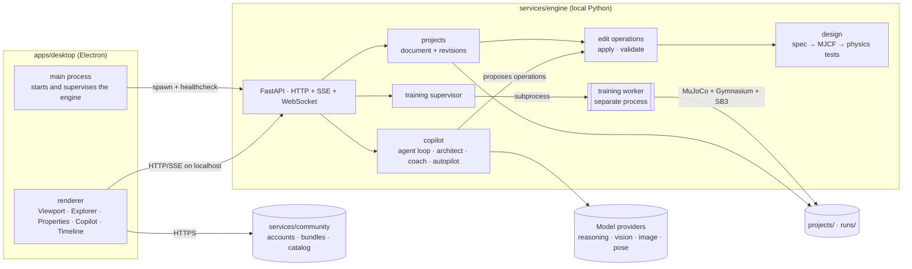

# Architecture

This document explains how Icarus Studio 3D is built. Product direction lives in [`VISION.md`](../VISION.md); when the two disagree, the vision wins and this document is updated.

## System overview

Icarus Studio 3D has three parts:

- **Desktop studio** (`apps/desktop`): Electron, React and React Three Fiber. A 3D editor that expresses intent and renders state.
- **Engine** (`services/engine`): a local Python service that owns projects, the parts library, design compilation, the copilot, simulation, training, motion, hardware export and storage.
- **Community service** (`services/community`): an online service for accounts and for publishing, browsing and downloading creations.



**Authority.** The renderer expresses intent and renders state. The engine validates, orchestrates and owns the data. MuJoCo is the only source of physical truth; the viewport draws the compiled physical model and replays states MuJoCo computed.

## Core idea: one project document, one edit model

Everything a user creates lives in a **project document**: a typed, versioned description of a world, one or more bodies, a task and a brain.

```text
Project
├── WorldSpec      terrain, surfaces, static and dynamic objects, goals, lighting
├── BodySpec[]     parts tree: rigid parts, joints, actuators, sensors, skin
├── TaskSpec       task family, observations, actions, reward terms + weights, terminations
├── BrainSpec      algorithm, network template, training budget, randomization
└── HardwareProfile?  real components the bodies must be built from
```

The document changes only through **edit operations** (`add_part`, `connect_joint`, `set_joint_limits`, `add_sensor`, `set_reward_weight`, `set_surface_friction`, …). The editor emits operations when a user drags a gizmo or edits a property; the copilot emits the same operations when it designs or repairs something. The engine applies them, validates the result and records a revision.

This gives every change, human or AI, the same guarantees: validated before it lands, visible as a diff, undoable, and attributable in the revision history. The copilot has no other way to change a project.

## Repository layout

```text
icarus-studio-3d/
├── AGENTS.md                 # rules for agents and contributors
├── VISION.md                 # product truth
├── README.md
├── package.json              # root scripts orchestrating TS + Python
├── pnpm-workspace.yaml
├── biome.json
├── .env.example
├── apps/
│   └── desktop/
│       ├── AGENTS.md
│       └── src/
│           ├── main/         # window, engine process supervision
│           ├── preload/      # contextBridge API
│           └── renderer/
│               ├── app/      # launcher and workspace shells, headers, routing, dock layout
│               ├── editor/   # viewport, toolbar, gizmos, selection, explorer, inspector, property controls, undo
│               ├── features/
│               │   ├── copilot/         # chat, attachments, steps, scene views, action buttons, history, autopilot
│               │   ├── ideas/           # three design ideas and live builds
│               │   ├── world-studio/    # world tools, library, training copies
│               │   ├── body-studio/     # rig, import, auto-rig, rig check
│               │   ├── brain-studio/    # senses and actions, learning, brain shape, connectome activity
│               │   ├── play/            # Play mode: tools, senses, decisions, vision, events
│               │   ├── train/           # runs, metrics, live copies, replay, coach messages, Diagnose now
│               │   ├── results/         # runs, best brain, comparison, failure groups, diagnoses
│               │   ├── motion-studio/   # reference video → motion → export
│               │   ├── build-studio/    # build targets, export, hardware
│               │   ├── home/ · projects/ · project/  # home, project list, project menu and dialogs
│               │   ├── settings/        # AI models, profile, privacy, training, notifications
│               │   ├── community/ · account/ · notifications/ · moderation/
│               ├── scene/    # R3F rendering of compiled models, rollouts and Play streams
│               ├── engine-client/       # typed HTTP + SSE client for the engine
│               ├── community-client/    # typed client for the community service
│               └── ui/       # shadcn components on top of the design tokens
├── packages/
│   ├── contracts/            # TypeScript types generated from the engine
│   └── ui-tokens/            # design tokens: one TS source → CSS variables, Tailwind theme, scene constants
├── services/
│   ├── engine/
│   │   ├── AGENTS.md
│   │   ├── pyproject.toml
│   │   ├── src/icarus/
│   │   │   ├── api/          # FastAPI routers
│   │   │   ├── contracts/    # Pydantic models: the single contract
│   │   │   ├── library/      # components and property schemas, reward terms, templates
│   │   │   ├── projects/     # project store, revisions, edit operations, validation
│   │   │   ├── design/       # spec → MJCF compiler, sky, courses, design checks, scene export
│   │   │   ├── copilot/      # model client, agent loop and tools, ideas, builds, coach, autopilot, skills, memory
│   │   │   ├── sim/          # Gymnasium env, rewards, per-copy variation, Play, offscreen views
│   │   │   ├── training/     # worker, supervisor, run store, evaluation, frames, failure groups, warm start
│   │   │   ├── events.py     # in-process event bus
│   │   │   ├── tasks.py      # background tasks registry
│   │   │   ├── motion/       # planned: pose extraction, retargeting, animation export
│   │   │   ├── hardware/     # planned: profiles, parts lists, URDF/ONNX export, runtime package
│   │   │   └── bundles/      # planned: pack and unpack shareable bundles
│   │   └── tests/
│   └── community/            # online service: accounts, bundle storage, catalog
├── assets/
│   ├── library/              # meshes and textures for library parts and presets, with licenses
│   └── presets/              # ready-made bodies and worlds (including commercial robots)
├── projects/                 # local projects (not versioned)
├── runs/                     # local training output (not versioned)
└── docs/
    ├── architecture.md
    ├── design/               # screen catalog, style guide, design tokens
    ├── decisions/            # ADRs
    ├── agents/               # detailed guides referenced from AGENTS.md
    └── plans/                # working plans
```

- **pnpm workspaces without a task runner.** Root scripts call both languages, so `pnpm check` verifies the whole repo.
- **The contract lives in Python** next to the validation that enforces it; `packages/contracts` is generated.
- **One local engine, several processes.** Design, copilot, simulation and training share one model of the world. The API never trains; the worker does.
- **The community service is separate** because it is online, multi-user and deployed, while the engine is local and single-user.

## The contract

`services/engine/src/icarus/contracts/` defines every structure that crosses a boundary, as Pydantic v2 models with `extra="forbid"` and explicit ranges.

| Model | Purpose |
|---|---|
| `Project`, `Revision` | The project document and its history (author: user or copilot, operations, parent) |
| `WorldSpec`, `BodySpec`, `TaskSpec`, `BrainSpec` | The four parts of a project |
| `HardwareProfile` | Allowed real components and their physical limits |
| `EditOperation` | Discriminated union of every allowed change to a project |
| `DesignReport` | Compilation and physics test results for a revision |
| `SceneDescription` | Bodies and geoms (type, size, material, mesh, skin) from the compiled model |
| `RunConfig`, `RunStatus`, `MetricPoint`, `CheckpointInfo` | Training runs and their progress |
| `Rollout` | `fps`, body names, per-frame body poses (position xyz, quaternion wxyz), episode metrics |
| `CopilotMessage`, `CopilotProposal` | Conversation turns (with attachments, steps, scene views and action buttons) and proposed operations with explanations |
| `Diagnosis`, `FailureGroup` | Observations, evidence (frames, metrics), failure groups, hypotheses, a recommendation and proposed operations |
| `AutopilotStart`, `AutopilotStatus` | The autopilot loop: mode, goal, budget, iterations and log |
| `WarmStart` | A run that continues from another run's checkpoint |
| `EngineEventEnvelope`, `TaskInfo` | Engine events (turns, steps, views, proposals, revisions, runs, diagnoses, tasks) and background tasks |
| `SceneZone`, `SceneSky` | Task zones (spawn, goal, marked areas) and the world sky in a `SceneDescription` |
| `SceneSignals` | Per frame of Play, rollouts and the live view: which goal rules hold, which vehicle lights are on, each floor plate's state and each display's value, measured by the engine |
| `ScenePlate`, `SceneDisplay`, `SceneEyes` | Floor plates, digital displays and eyes in a `SceneDescription`, with the part a display or eyes sit on |
| `ObjectSpec`, `ComponentSpec` | Any object in a world or body as a list of typed components |
| `PropertySchema` | A component property: one of the 13 property types, unit, range, default, expert flag, randomizable |
| `DesignIdea` | One of the alternatives the copilot proposes before building, with its preview and estimates |
| `PlayCommand`, `PlayFrame`, `PlayEvent` | Play mode: tool actions from the user, streamed states and the behavior log |
| `BehaviorTest`, `ReferenceRecording` | Recorded real behavior and how a simulated run is measured against it |
| `MotionClip` | Reference motion retargeted to a body, with source and frame timing |
| `BundleManifest` | Contents, versions, lineage and checksums of a shareable bundle |

`pnpm gen:contracts` exports JSON Schema from these models and generates `packages/contracts/src/generated.ts`. `pnpm check` fails if the generated file is stale. Generated files are never edited by hand.

## Engine

**Stack:** Python 3.12 managed by uv · FastAPI · Pydantic v2 · MuJoCo · Gymnasium · Stable-Baselines3 · PyTorch · ONNX · ruff · pyright · pytest.

### Processes

- **API** (uvicorn) answers requests, applies operations, runs fast design tests, reads project and run directories and streams events. It never imports the training stack on a request path.
- **Training worker** (`python -m icarus.training.worker <run_dir>`) is launched by `training/supervisor.py` as a subprocess with vectorized environments (`SubprocVecEnv`). It writes everything into its run directory and saves a final checkpoint when asked to stop. The supervisor executes one training run at a time per machine by default and queues the rest.

### Library

`library/` holds the building blocks every design is assembled from. Nothing outside the library can appear in a project.

- **Parts:** parametric rigid shapes (capsule, box, sphere, cylinder, wheel, gripper finger) with density or mass ranges.
- **Joints:** hinge, slide, ball and fixed, with axis and limit ranges.
- **Actuators:** position and torque motors with force, speed and gear ranges; hardware components map to these with real limits.
- **Vehicles:** a `vehicle` component on a body's root turns any wheeled body (car, truck, three-wheeler, two-wheeler, tracked or skid-steer robot) into three brain actions, throttle, brake and steering, in place of its raw motors ([ADR 009](./decisions/009-vehicle-actions.md)). `design/vehicle.py` finds the wheels (hinges with no limits turning sideways) and steering joints (limited upright hinges) and compiles a torque motor per drive wheel, a damper per wheel for the brake and a position servo per steering joint; `sim/vehicle.py` maps the actions with Ackermann geometry or differential drive and a speed limit, and derives brake, reverse and head light states. Parts with a `vehicle_light` glow from those states. Bodies without the component keep one action per motor.
- **Sensors:** joint state, IMU, contact, rangefinder rays (one fan or a 360° ring through `spread`), speed (forward and side speed, turn rate), target (distance and bearing to the goal zone and which way it faces), simple depth camera.
- **Ground:** a `ground` component makes an object the world's floor, a static slab whose `size` (width, depth, thickness) the inspector and the copilot edit and whose top stays at the object's height; bodies that leave it fall off its edge ([ADR 010](./decisions/010-ground-slab.md)). New projects start on a 100 by 100 m slab. A ground plane stored by older projects stays endless in the physics and is drawn out to the horizon; adding the component to it turns it into a slab.
- **Surfaces and objects:** ground materials (friction, restitution), ramps, steps, obstacles, movable objects, goal zones, parking spots. Ready-made pieces (`library/pieces.py`) come in categories (basics, street, buildings, furniture, nature, props); each is one collider with mass or fixed, a surface for friction and a style drawn inside it, and look-only finish, roughness, metalness, glow and rounded box edges (`material.bevel`, drawn inside the collider, which stays a sharp box) that never change what a brain learned. The `block` piece is a fixed 1 m cube drawn with the `blocks` finish (a tile per metre on every face); the copilot's `pattern` grid, with layers stacked up, builds floors, platforms, steps and walls from it. Spheres stand beside boxes: the `ball` (movable) and `sphere` (fixed) pieces, and Play's Add object places a box, ball, block or sphere.
- **Layouts:** seeded, parameterized recipes (`library/layouts.py`: parking lot, room, maze or corridor, city blocks, warehouse, forest or park, obstacle course, steps, block terrain) that lay out a whole environment from library pieces as plain `create_object` and `set_property` operations, grouped by area under one root, with the spawn at the start, the goal zone at the goal and the way between them checked open on a floor plan; a world on a ground slab grows the slab to hold everything laid out. Which piece draws each element lives in one table (`library/layout_pieces.py`), falling back to a styled primitive when the piece is absent.
- **Skins:** a look-only `skin` component draws a glTF or GLB model stored in the project's `skins/` folder over an object, fitted inside its collider ([ADR 008](./decisions/008-mesh-skins.md)). Models are validated when stored (`projects/skin_files.py`: size cap, embedded buffers and textures only, no decoder extensions) and an import (`projects/skin_import.py`) adds an object with a box or capsule collider fitted to the model and mass from density.
- **Floor plates, displays and eyes:** a `plate` component lays a thin static plate on the floor (pressure, target, start pad or custom) that compiles as a floor patch, never an obstacle; `sim/plates.py` measures it pressed (contact force from what it watches above its press force) or occupied (that thing's center over it) every step, and which goal plates a try has reached, in order when asked ([ADR 011](./decisions/011-floor-plates-and-displays.md)). A look-only `display` shows an engine value as a digital panel or a bar (time, steps, tries, the brain's training steps, successes, reward, distance or progress to the goal, a sensor, plates reached, or fixed text), and look-only `eyes` blink and look on a character's face; new walkers and humanoids have eyes.
- **Reward terms:** tested, documented terms such as forward progress, reach target, stay upright, alignment, grasp, place, energy cost, collision penalty and motion tracking, each with weight ranges.
- **Brain templates:** network sizes, observation normalization and training budgets known to train for each task family.
- **Connectomes:** published wiring maps of real nervous systems with their neuron model and the body they belong to, plus the sensory and motor mapping onto that body.
- **Hardware components:** real servos, motors, boards and sensors with their specifications, plus complete commercial robot presets.

### Projects and edit operations

- `projects/` stores each project as a directory with its current document and an append-only revision log.
- Applying operations produces a candidate document that is validated structurally (types, ranges, references), then compiled and tested by `design/` before it becomes a revision.
- Undo and redo walk the revision log. Copilot revisions are marked as such and can be reverted as a unit.

### Objects, components and property types

Everything in a world or body is an **object made of components**, whether it comes from the library, from the copilot or from an imported file. This is what lets the same editor handle a car, a fly, a robot arm or anything a user imports.

- **Components** come from the library: Transform, Mesh, Material, Skin, Light, Physics body, Collider, Joint, Motor, sensors (distance ray, camera, touch, balance, smell, sound), brains (learned, connectome, from the community), learning (goal, reward term, randomize per copy) and world pieces (spawn point, zone, wind, water).
- Each component declares its properties with a `PropertySchema`. Every property has one of **13 types**: number, slider, range, choice, list, switch, color, vector, count, asset, panel, read-only and text. The type, unit, range and default are enough for the desktop to render the right control, for the copilot to know what it may change, and for validation to reject anything out of range.
- Properties marked `expert` are grouped under *Expert settings*; properties marked `randomizable` can be varied per training copy.
- Adding or removing a component, and changing a property, are edit operations like any other.

### Design ideas

When a project starts from a sentence, the Architect first returns three `DesignIdea`s: different worlds, bodies and tasks, each compiled into a preview and an honest training estimate. Nothing is built until the user picks, mixes or tweaks one; the chosen idea becomes the first revision through ordinary edit operations.

### Design compilation and tests

- `design/compiler.py` turns `WorldSpec` + `BodySpec` into an MJCF model, computing inertias from part geometry and mass.
- `design/checks.py` runs fast physics checks on every candidate revision: it compiles, the goal zone stays clear of every obstacle collider across its own and the obstacles' randomization (`design/reachable.py`, sampling a grid of each range) and the body starts outside every obstacle, it settles at rest without exploding, every actuator moves its joint, sensors return finite values, bodies fit their hardware profile when one is set.
- Failures become a `DesignReport` with readable reasons. The copilot receives the report and repairs the design through new operations, up to a fixed number of attempts.

### Simulation

- `sim/` builds a Gymnasium environment from a compiled project: observations from the body's sensors, actions from its actuators, a reward composed from the task's reward terms, terminations from the task family.
- Task families: **locomotion** (walk, run, climb, cross obstacles), **manipulation** (reach, grasp, sort, stack), **navigation** (go to target, park, follow path, avoid obstacles) and **imitation** (track a motion clip). New families are added to the library, not invented per project.
- **Goal rules:** a goal zone is a circle or an oriented rectangle, and a try succeeds when its rules hold together: inside (the agent's center, or its whole footprint with `fully_inside`), aligned with the spot's heading within a tolerance (either way, nose in or back in) and slower than its stop speed (`sim/goal.py`). A circle without the new rules is measured exactly as before, so stored projects train and play unchanged.
- **Falling:** a try ends as a fall in every task family once the agent's root drops 1 m below the top of the lowest ground (off a slab's edge), besides each family's own rule (a vehicle rolled over, a legged body down).
- **Spawn:** the world's first spawn point says where tries start (`spawn_point.mode`, `sim/start_pose.py`): auto keeps the classic start (a navigation agent shifted up to ±1.5 m beside, 2 m behind and ±35° from where it stands; others exactly there), fixed starts on the spawn point, area anywhere in its `area` turned within `heading_range`, and random_point or cycle_points at one of the world's spawn points, each with its own area and heading range. Starts draw from the copy's seeded generator, and a seeded reset restarts the cycle at the seed's spawn point, so training copies vary while evaluations on fixed seeds repeat the same starts. Play draws a new start on each reset unless the mode is auto.
- **Plates as goals:** with `reach_plates` (mode any, all or in order) a try succeeds once its goal plates are reached, in any family; `plates_pressed` pays each newly reached plate and `on_plate` each step on one. Play's "What happened" tells each plate the first time it is reached in a try.
- **Randomization** varies masses, friction, actuator strength and latency, and sensor noise within ranges set by the brain spec, to make policies robust and transferable.
- **Per-copy variation:** a *Randomize per copy* component on an object varies a world object's position, rotation, color and friction within set ranges, applied by `sim/variation.py` on every try, so each training copy sees a different world; `GET /projects/{id}/copies` lets the desktop preview them.
- `sim/views.py` renders the compiled scene offscreen with MuJoCo from named cameras (with the task's zones drawn) for the copilot's vision and for the frames stored at every checkpoint; `design/scene.py` produces the `SceneDescription` the viewport draws, including the task zones (spawn, goal, marked areas) and the world sky (`design/sky.py`).
- Every environment passes `gymnasium.utils.env_checker.check_env`.

### Brains

A body is driven by one brain component:

- **Learned:** a policy network trained with reinforcement learning (or imitation for motion), the default.
- **Connectome:** a simulated nervous system built from a published wiring map. Its sensory neurons receive the body's senses and its motor neurons drive the body's actuators through an explicit mapping; nothing is trained. Unmapped neurons stay silent and are reported.
- **From the community:** a learned brain someone else published, validated like any bundle.

### Play mode

Play steps the physics live with the current brain and streams `PlayFrame`s to the viewport, in the engine, never in the renderer. The user acts on the running world with `PlayCommand`s: move, push, add an object, change light or wind, slow down, reset, plus stimuli derived from the body's senses (shadow for vision, scent for smell, touch for touch sensors). Play never changes the project; a `PlayEvent` log records behavior and user actions, and any session can be saved as a clip.

### Comparison with real behavior

A `BehaviorTest` replays a scripted situation and measures the simulated body against a `ReferenceRecording` (walking paths, reaction times, gait). Results report each behavior as recorded value, simulated value and whether it is within the recorded range; tests without data are reported as not run.

### Training and the Training Timeline

- PPO from Stable-Baselines3, on CPU by default, using a GPU only when available and only for speed.
- A checkpoint schedule (log-spaced by default: 0, 25k, 50k, 100k, 250k, 500k, 1M, …) gives the timeline detail where learning changes fastest.
- At every checkpoint the worker saves the policy, runs deterministic evaluation episodes with fixed seeds, records the first one as a `Rollout` and stores its metrics.
- For walking bodies each evaluation episode also records gait signals measured by MuJoCo (root height, tilt, drift, each foot's ground contact and lift-offs, joints at their limits, action change), which `training/run_health.py` turns into facts the coach quotes; the locomotion gait reward terms answer them.
- Checkpoint 0 is the untrained policy, so every run carries its own before/after baseline.
- The live view replays what the copies really did. Copies capture a pose only on the steps the view will show; a few times a second the worker writes `live.json` with each copy's frames since the previous write, in contiguous episode segments, within about 100 KB/s. `status.json` names the worker's phase (practicing, updating the brain, testing a checkpoint), so the view always shows a run moving.

### Experiments file

Behaviors still being compared before one becomes the default are switched in `experiments.json` in the settings folder (`~/.icarus`, `ICARUS_SETTINGS_DIR` overrides it), declared in the `Experiments` model (`contracts/experiments.py`) and read by `training/experiment_switches.py`. A missing file, key or invalid value keeps the default. Switches today: `live_view` — `"realtime"` (default: recorded motion at 1x sim speed, about 3 s behind), `"fast"` (recorded motion sped up to keep pace with training) or `"classic"` (one pose per snapshot, eased). The worker reads it when a run starts and the snapshots say which mode they were recorded for. `coach_patience` — a share of the task's recommended steps from 0.1 to 1 (default `0.5`): before a brain has trained that share, counting the runs it continues from, the coach does not call a run stalled or flat, the autopilot does not change the design for slow progress and continues from the best brain instead. A design problem found by a look, by a watch rule other than the stall, or by the design tests still stops a run at once.

### Run store

Runs live next to the projects in the data folder, `~/Icarus Studio` by default (`projects/` and `runs/`), so reinstalling the app never deletes a trained brain. Settings › Training and hardware › Storage chooses another data folder, saved in `storage.json` in the settings folder; the engine copies every project and run there, verifies each byte for byte before removing the original, refuses while anything trains and is restarted by the app to use it. `ICARUS_PROJECTS_DIR` and `ICARUS_RUNS_DIR` always win over the saved folder. On start the engine moves runs left in the older `services/engine/runs` folder into it, removing each original only after its copy is verified.

```text
runs/<run_id>/
├── run.json             # RunConfig: project id, revision, seed
├── project.json         # frozen copy of the project revision
├── meta.json            # library versions, git revision, timestamps
├── status.json          # RunStatus, written atomically
├── metrics.jsonl        # MetricPoint per line, append-only
├── checkpoints/<step>.zip
├── rollouts/<step>.json
├── frames/<step>/       # rendered episode frames and episodes.json (how each episode ended)
├── diagnosis/<n>.json
├── live.json            # the copies' newest poses and recorded frames for the live view
└── worker.log
```

A run directory is self-contained: it can be reproduced or shared without the rest of the project history.

### Copilot

`copilot/client.py` is the only module that calls models. Each **capability** is configured with its own OpenAI-compatible endpoint and model:

| Capability | Used for |
|---|---|
| `reasoning` | Conversation, design, diagnosis, explanations |
| `vision` | Reading rendered episodes, reference frames and screenshots |
| `image` | Skins, textures and thumbnails |
| `pose` | Extracting body pose from reference video frames |

Copilot roles, all producing typed outputs and, when they change a project, `EditOperation`s:

| Role | Does |
|---|---|
| **Architect** | Proposes three design ideas, then turns the chosen one into a full project (world, bodies, task, brain), asks for missing details, refines on request |
| **Coach** | Watches live metrics, reviews rendered rollouts at checkpoints, groups failures, produces a `Diagnosis` with proposed operations, runs the autopilot loop |
| **Motion** | Turns a reference video into a `MotionClip` retargeted to a body |
| **Builder** | Adapts a body to a hardware profile and explains how to build it |
| **Artist** | Generates skins, textures and thumbnails |
| **Guide** | Explains anything on screen: a joint, a reward term, a curve, someone else's creation |

Rules for every role:

- Roles that return one structured output request it with a JSON Schema derived from the target model, validate it with Pydantic, retry once with the validation error, and otherwise surface a readable error.
- The chat copilot is an agent loop (`copilot/agent/`, [ADR 006](./decisions/006-copilot-agent-loop.md), [plan](./plans/copilot-agent-harness.md)): each step is one model call with native tools (`inspect_object`, `read_run`, `library`, `look`, `try`, `layout`, `build_object`, `reference_scene`, `propose`, `apply`, `train`, `coach`) whose arguments are validated with Pydantic; a rejected call goes back to the model as the tool result. `try` applies operations to a copy and runs the design, placement and trainability checks; `look` renders the compiled scene offscreen with MuJoCo (`sim/views.py`) with the task's zones drawn. `build_object` assembles a part plan (primitives with relative transforms, a look per part, joints and motors) into a static group or a body after checking its structure, scale and mass; `reference_scene` asks a model for a scene plan from the person's words and reference picture, builds and tries it, renders it from the reference's estimated camera and lets a model that sees compare and correct it for up to three rounds, reporting what it could not place (`copilot/reference_scene.py`, `copilot/building/part_plan.py`, `scene_plan.py`). The turn ends on the `answer` tool, grounded like every other output, or on a forced answer when a budget (steps, tool calls, time, tokens) runs out. The autonomy mode, not the prompt, decides what may write: in ask mode the copilot proposes and offers a Train button; in autopilot it may apply and train. Steps, renders and buttons are stored on the copilot message. Older messages are folded into a rolling summary when the history outgrows its share of the model's context window. The context meter (`POST /projects/{id}/conversation/context`, `copilot/agent/context_usage.py`) builds the next turn's first request the same way, without a model call, and measures each piece (system prompt, tools, skills, memory, project context, summary, history, message, attachments) with the budget's token counter, with the reserved answer room and when history folds next.
- **Attachments:** images and short videos attached in the chat are stored per project (`POST /projects/{id}/attachments`); video is sampled into frames, and both reach the `vision` capability as part of the turn. A glTF or GLB model attached is also stored as a skin, and the turn tells the copilot its id and size so it can put it on an object with a `skin` component.
- **From-scratch designs** are built by stages (world, bodies, task), each stage tested on top of the ones before, with placement and trainability checks.
- **Harness extensions** ([plan](./plans/copilot-harness-extensions.md)): an in-process event bus (`events.py`) publishes turns, steps, views, proposals, revisions, run events, diagnoses and tasks; long work runs as background tasks (`tasks.py`) with cooperative cancelling and a final event; **skills** are Markdown procedures the copilot reads on demand (eight built in: diagnosing a brain, reward design, curriculum and warm start, sensors for a task, environment look, parking and navigation, race and obstacle course, walking robot); **memory** keeps notes scoped to a project or the person, always with their source (`remember`, `recall`); **comparison** tools compare two runs on the same evaluation seeds and two revisions. Their HTTP routes (`/events`, `/tasks`) and loop wiring are landing now; hooks, subagents and code-free extensions are planned.
- Model reasoning is separated from the final answer in the client and can be shown as "how the copilot thought about it".
- Any number the copilot cites about a run must exist in that run's data; otherwise the output is rejected.
- No model output changes a project except through validated edit operations, and nothing a model returns is executed.

### Coach and autopilot

See [`plans/sprint-07-coach.md`](./plans/sprint-07-coach.md).

1. At every checkpoint the worker stores frames of the first evaluation episodes (`runs/<id>/frames/<step>/`) and groups episodes by how they end (`training/failure_groups.py`). Watch rules in code (`training/progress_watch.py`: no progress, reward without success, instant failures) flag a run that is not learning.
2. A diagnosis (`copilot/coach.py`, on request or when a rule fires) is an agent turn with the run tools plus `look_episode` that returns a `Diagnosis` grounded in the run's numbers: observations, evidence, failure groups, a hypothesis, a recommendation (`keep_training`, `stop_and_fix`, `done`) and, for a fix, a tested proposal.
3. The user can review and apply the proposal. The **autopilot** (`copilot/autopilot.py`; mode `ask` waits for approval at each proposal, mode `fix` applies by itself) trains, watches, diagnoses, fixes and retrains, warm-starting from the best checkpoint when the fix keeps what the body senses and how it acts (`training/warm_start.py`), compares the new run with the previous one on the same seeds and keeps the best brain, until the goal success or the budget (iterations, minutes) runs out. Each step posts a copilot message with frames and buttons.
4. Every iteration stays in the revision log and the run list, so the evolution of the design is as visible as the learning of the brain.

### Motion

1. Frames are sampled from a reference video and sent to the `pose` capability, producing per-frame body keypoints.
2. `motion/retarget.py` maps the keypoints onto the target body's joints, producing a `MotionClip`.
3. The `imitation` task family trains a policy to track the clip under physics.
4. `motion/export.py` bakes the resulting rollout into a skeletal animation (glTF, with FBX for engines that need it).

### Hardware

- A `HardwareProfile` constrains design: parts map to real components, actuators inherit real torque and speed limits, dimensions follow real parts.
- `hardware/` exports a project as URDF and MJCF, the trained policy as ONNX, a parts list, and a small runtime package that reads sensors, runs the policy and drives actuators on a single-board computer.
- Commercial robots are library presets with their published models and limits; their bodies are fixed and only their brains are trained.

### Bundles

`bundles/` packs worlds, bodies, brains, motion clips or whole projects into a versioned archive with a `BundleManifest`, lineage (the bundle it was derived from) and checksums. Import validates every part against the library and contract versions. Bundles never contain executable code.

### HTTP API

Routes that exist today (`services/engine/src/icarus/api/`):

| Method | Route | Purpose |
|---|---|---|
| `GET` | `/health` | Liveness for the desktop main process |
| `GET` | `/library` · `/library/templates/{id}/scene` | Components with their property schemas, reward terms, templates · a template's scene for thumbnails |
| `GET` · `POST` | `/projects` | List · create |
| `GET` · `DELETE` | `/projects/{id}` | Current document, revision, `DesignReport` · delete |
| `POST` | `/projects/{id}/operations` | Apply edit operations → new revision or validation errors |
| `GET` | `/projects/{id}/revisions` | Revision history |
| `POST` | `/projects/{id}/revisions/{n}/restore` · `/duplicate` | Restore a revision · duplicate the project |
| `POST` | `/projects/{id}/undo` · `/redo` | Walk the revision log |
| `GET` | `/projects/{id}/scene` · `/projects/{id}/copies` | `SceneDescription` for the current revision · the training copies with their per-copy variation |
| `WS` | `/projects/{id}/play` | Play session: `PlayCommand`s in, `PlayFrame`s and `PlayEvent`s out |
| `POST` · `GET` | `/ideas` · `/ideas/{id}` | Three `DesignIdea`s with previews for a sentence |
| `POST` · `GET` | `/builds` · `/builds/{id}` | Build a chosen idea, with progress |
| `GET` | `/projects/{id}/conversation` | The project's copilot conversation |
| `POST` | `/projects/{id}/conversation/messages` · `/autonomy` | Send a message (one agent turn) · set the autonomy mode |
| `POST` · `GET` | `/proposals/{id}/apply` · `/discard` · `/scene` | Apply or discard a proposal · its preview scene |
| `POST` | `/projects/{id}/attachments` | Attach an image or video to the chat |
| `GET` | `/attachments/{id}/content` · `/frames/{index}` | An attachment · a sampled video frame |
| `POST` · `GET` | `/projects/{id}/skins` · `/projects/{id}/skins/{asset}` | Import a glTF or GLB model as an object that wears it · a stored model |
| `POST` · `GET` | `/projects/{id}/runs` | Start training the current revision (optionally warm-started) · list runs |
| `GET` | `/runs/{id}` · `/runs/{id}/events` | Status · SSE stream of metrics, checkpoints and diagnoses |
| `POST` | `/runs/{id}/stop` | Request stop |
| `GET` | `/runs/{id}/metrics` · `/checkpoints` · `/rollouts/{step}` · `/scene` | Run data: curves, checkpoints, replays, the run's frozen scene |
| `POST` · `GET` | `/runs/{id}/diagnosis` · `/runs/{id}/diagnoses` | Ask the coach for a diagnosis · every diagnosis of the run |
| `GET` | `/runs/{id}/checkpoints/{step}/failures` | Failure groups of a checkpoint with their frames |
| `POST` · `GET` · `DELETE` | `/projects/{id}/autopilot` | Start · status · stop the autopilot loop |
| `GET` · `PUT` | `/settings/training` | Training settings |
| `GET` · `PUT` · `POST` | `/settings/models` · `/settings/models/test` | Model connections per capability · test a connection |
| `GET` | `/events` | Engine events stream (router built, not yet mounted) |
| `GET` · `DELETE` | `/tasks` · `/tasks/{id}` | Background tasks · cancel one (router built, not yet mounted) |

Planned: `POST /motion/clips`, `POST /runs/{id}/behavior-tests`, `POST /projects/{id}/export`, `POST /bundles/pack` · `/bundles/unpack`.

## Desktop studio

**Stack:** Electron · electron-vite · electron-builder · React · TypeScript (strict) · React Three Fiber + drei · Tailwind CSS + shadcn/ui · TanStack Query · Zustand · Recharts · Biome · Vitest.

Every screen, module and tab has an identifier in [`docs/design/screens.md`](./design/screens.md); the visual rules are in [`docs/design/STYLEGUIDE.md`](./design/STYLEGUIDE.md) and the values in [`docs/design/tokens.md`](./design/tokens.md). Each module is a folder and each tab a file.

**Workspace layout**, in the tradition of game and simulation studios:

- **Header**: project menu, workspace switcher (World, Body, Motion, Brain, Train, Results, Build, plus the ones a project adds), Play, guide, Share and the next-step action.
- **Left column**: Explorer (the object tree) over the Inspector (components and typed properties of the selection).
- **Center**: workspace toolbar, viewport (camera modes: free, follow, onboard and top, plus frame all; the task's spawn and goal zones and the world sky are drawn; selection, gizmos with snapping, joint axes and limits, sensor rays and contacts, copilot ghosts) and a bottom panel per workspace (library, rig check, learning, metrics, timeline).
- **Right column**: the copilot, always visible: chat with attachments, the steps the copilot took, the scene views it rendered, action buttons, proposals previewed in the viewport and applied only on approval, and the project history. In Train the coach's messages and a *Diagnose now* action appear in the same chat; Results reads runs, comparisons, failure groups and diagnoses from the engine.
- **Workspaces**: World, Body, Motion, Brain, Train, Results, Build; **Play** is a mode available from any of them; the launcher holds Home, Projects, Community, Profile and Settings.

Implementation:

- **Main process** starts the engine with `uv run icarus-engine --port <free port>`, waits for `/health`, passes the URL through preload and restarts the engine on request if it exits. `ICARUS_ENGINE_URL` points the app at an engine already running during development.
- **Security:** `contextIsolation: true`, `nodeIntegration: false`, no secrets in the renderer; model credentials live only in the engine's environment.
- **Editing:** gizmos and property edits produce `EditOperation`s sent to the engine; the viewport updates from the resulting revision. Optimistic previews are allowed, but the engine's revision is the truth.
- **Scene:** a `SceneDescription` becomes R3F meshes. `RolloutPlayer` applies rollout frames with time-based interpolation; coordinate conversion (MuJoCo Z-up, wxyz → Three.js Y-up, xyzw) lives in one module.
- **Play mode** opens a play session in the engine, sends tool actions and draws the streamed frames; the renderer never steps physics.
- **Inspector** renders each property from its `PropertySchema` type, so new components need no new editor code.
- **Presentation mode** hides editing chrome and drives a cinematic camera over any rollout, with real metrics as overlays.

## Distribution

Icarus ships as one installable application per platform (Windows, macOS, Linux) built with electron-builder. The installer bundles the engine source, its locked dependencies and a portable Python runtime managed by uv, so users never install Python or run a server themselves. On first launch the main process prepares the engine environment once, then starts and supervises it on every launch. Electron is used over a system-webview shell so the 3D viewport runs on the same Chromium and graphics stack on every platform.

## Community service

`services/community` is an online service with accounts, bundle storage, a searchable catalog with previews (thumbnails, short rollouts) and lineage between creations. The desktop app talks to it through `community-client`; uploads and downloads are bundles produced and validated by the engine, and validated again by the service before they are stored. Its stack and hosting are recorded in an ADR when it is built.

- **Open source and self-hostable.** The service lives in this repository and runs with one `docker compose up`. The maintainers operate the official instance; anyone can run their own, and the app's *Community server* setting chooses which one to use.
- **Accounts only for sharing.** Sign-in (Google, GitHub, email) is needed to publish, remix, vote and comment, never to create or train. The desktop app signs in through the system browser with OAuth PKCE and an `icarus://` deep link, and keeps the session in the operating system keychain.

## Quality

One command verifies the whole repository:

```bash
pnpm check
```

It runs `biome check`, `tsc --noEmit`, `vitest run`, the file-size guideline report (`check:max-lines`, warnings only), the contract staleness check, `ruff check`, `ruff format --check`, `pyright` and `pytest -m "not slow and not live"`.

| Layer | What is real | Command |
|---|---|---|
| Engine unit | operations, validation, library, compiler, reward composition, bundles | `pytest -m "not slow and not live"` |
| Design tests | compiled models settle, actuate and sense correctly | included above |
| Environment contract | `check_env`, seeded determinism | included above |
| Training smoke | real PPO for a few thousand steps with a fixed seed, producing a checkpoint, rollout and metrics | `pytest -m slow` |
| Copilot | `fake` provider with fixtures by default; real providers only with credentials | `pytest -m live` (no credentials = not run) |
| Desktop | pure logic: operations, player, coordinates, SSE parsing | `pnpm -F desktop test` |

## Working in parallel

Each change belongs to one zone and only touches files in that zone:

| Zone | Paths |
|---|---|
| `contracts` | `services/engine/src/icarus/contracts`, `packages/contracts` |
| `design` | `icarus/library`, `icarus/projects`, `icarus/design`, `assets/` |
| `sim` | `icarus/sim` |
| `training` | `icarus/training` |
| `copilot` | `icarus/copilot` |
| `motion` | `icarus/motion` |
| `hardware` | `icarus/hardware`, `icarus/bundles` |
| `engine-api` | `icarus/api` |
| `desktop` | `apps/desktop`, `packages/ui-tokens`, `docs/design` |
| `community` | `services/community` |

A contract change lands first and alone; other zones consume it afterwards. Parallel work uses one git worktree and one `feat/<zone>-<topic>` branch per task, and `main` always passes `pnpm check`.

## Open decisions

Decisions are recorded as ADRs in `docs/decisions/` once data settles them.

1. Default training budgets per task family, from measured learning curves on CPU.
2. Pose extraction pipeline and retargeting approach for motion clips.
3. Animation export formats and the runtime target for hardware export.
4. Community service stack, hosting and bundle format versioning.

Settled: edit operation granularity ([ADR 005](./decisions/005-edit-operation-granularity.md)).
